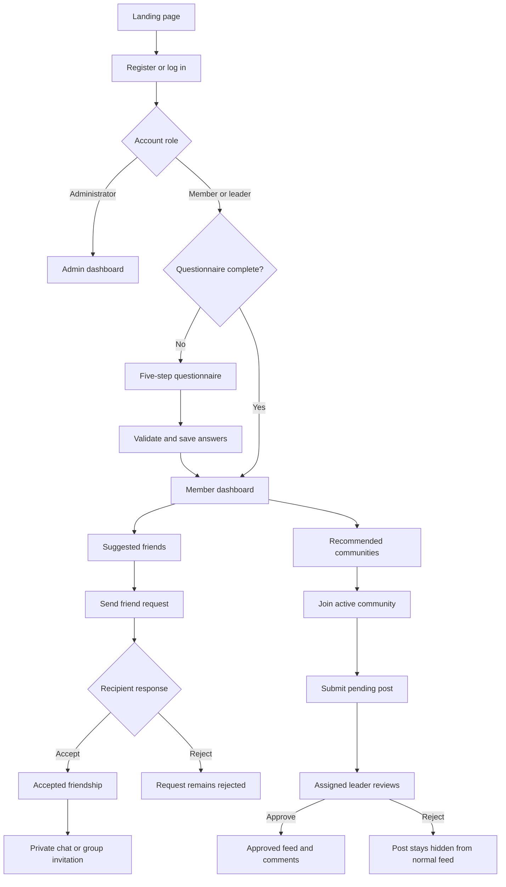
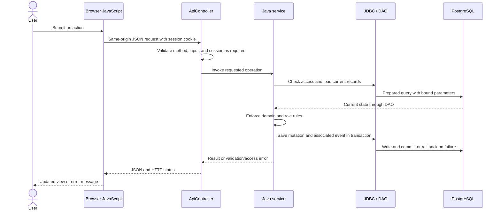

# Application flow

This guide describes implemented behavior. Proposed changes are listed separately in [improvements](improvements.md). Endpoint details are in the [API reference](api-endpoints.md).

## Member journey

## Registration, login, and onboarding

1. Registration validates name, username, email, password, and confirmation. The server stores a salted password hash and creates a `MEMBER` account and session.
2. The browser sends new members to the questionnaire. Existing members and leaders without saved answers are also redirected there; administrators use their own dashboard.
3. The questionnaire collects ten interest ratings and the experience, goals, collaboration, and activity preferences. At least one goal is required.
4. Saving replaces the member's persisted questionnaire values within a transaction. The browser opens the member dashboard.
5. Login accepts a username or email and checks the password and suspension state. Logout revokes the session; expiry or a server restart requires another login.

The recommendation API independently requires a completed questionnaire. Browser redirection is not the only enforcement point.

## Recommendations and friendships

The dashboard requests suggested members, communities, incoming requests, approved posts, and recent conversations. Member scores range from 0 to 100 and are sorted descending. Candidate retrieval excludes the current user, administrators, suspended accounts, incomplete profiles, accepted friends, and pending request pairs; it currently considers at most 200 candidates.

| Action | Result and rule |
|---|---|
| Send request | Creates a pending request to another active member; self and duplicate/reversed pairs are rejected |
| Accept | Only the recipient can accept; the accepted request represents the friendship |
| Reject | Only the recipient can reject; the row remains and prevents another request for that pair |
| Remove friend | Deletes the accepted request; a later request is possible |

Rejected pairs are excluded from recommendations in both directions. The stored rejected request still blocks another request; no retry policy was introduced.

## Conversations

Private chat creation verifies an accepted friendship and reuses an existing private conversation for that pair. The server inserts both participants when creating a new conversation. Reads require participation; sends also require both accounts to remain active and the private friendship to remain accepted.

Group creation takes a name and 1–19 active friends. The creator is added automatically, giving 2–20 initial participants. Participants do not all need to be friends with each other. Adding/removing participants after creation is not implemented.

The conversation list gets its display name through Java polymorphism: private conversations show the other member's name; groups show their stored name. The browser polls the selected chat every four seconds while visible and loads the latest 200 messages. An outsider cannot read or send. Suspending any participant pauses sending to that conversation. Removing a private friendship blocks new private sends but preserves history for participants.

## Community publishing and moderation

1. A member joins an active community before submitting content.
2. A submitted post starts as `PENDING` and is absent from the approved feed.
3. The currently assigned leader sees the pending queue and may approve or reject another author's post.
4. Approval makes the post visible in the normal feed. Community membership is required to add comments; pending/rejected posts do not accept comments.
5. A leader cannot approve their own post. With no alternative moderation path, reassignment is needed for another leader to review it. Administrators have no moderation override.

An assigned leader must be reassigned before leaving that community. Archiving hides a community from ordinary active-community lists without deleting historical data.

## Administration and reports

Administrators can search user summaries, suspend/reactivate non-admin accounts, create/edit/archive communities, and assign community leaders. Assignment promotes the target member to a leader and ensures community membership. A previously assigned leader retains the leader role but can moderate only communities currently assigned to them.

Suspension is checked on subsequent authenticated requests, including existing sessions. Administrators can view activity metadata and daily counts. Reports aggregate recorded events over UTC `[start of day, start of next day)` boundaries using typed timestamp parameters. They do not expose private-message text, and seeded posts/messages do not invent activity events.

## What happens inside an API request

This sequence describes a typical authenticated mutation. Public registration/login and read-only requests use different subsets of the steps. The server also serves frontend assets through `StaticController`; the browser and APIs share one origin.

## Checking the flow

Use the [README demonstration workflow](../README.md#demonstration-workflow) with separate browser profiles for concurrent roles. The [testing guide](testing.md) records passing API scenarios and the authenticated browser checks that still need execution.
