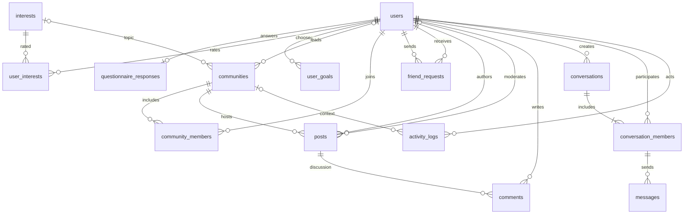
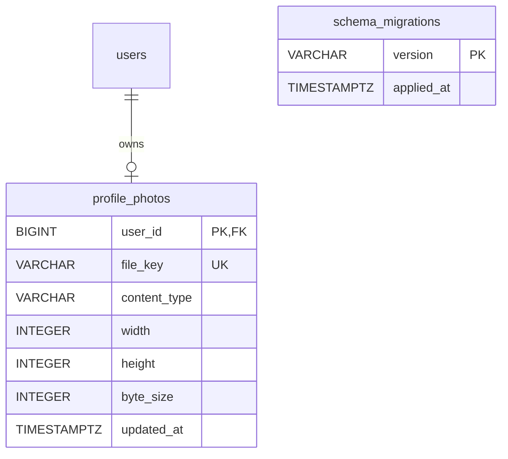

# Database design

PostgreSQL stores application data with identity primary keys, enum types, BOOLEAN flags, and TIMESTAMPTZ timestamps. Java normalizes emails to lowercase before storage; usernames use PostgreSQL case-sensitive equality and uniqueness. All tables use primary keys and relational foreign keys. Run the schema once in a new database; it is not an incremental migration script. The repeatable seed uses ON CONFLICT DO NOTHING and advances identity sequences after inserting fixed demo IDs.

| Table | Purpose and key constraints |
|---|---|
| users | Unique username/email, salted password hash, role, suspension, profile |
| interests | Topic records, unique names |
| questionnaire_responses | One response per user, controlled preference values |
| user_interests | Composite user/interest PK, rating CHECK 1–5 |
| user_goals | Composite user/goal PK, enumerated goal values |
| communities | Optional related interest, assigned leader FK, active flag, unique name |
| community_members | Composite user/community PK and joined timestamp |
| friend_requests | Sender/receiver FKs, state, self-request CHECK, unique unordered pair |
| posts | Community/author FKs, moderation state, moderator and timestamp |
| comments | Post/author FKs and body |
| conversations | Private/group type, creator, unique private pair, type/pair CHECK |
| conversation_members | Composite conversation/user PK |
| messages | Composite conversation/sender FK ensures sender is a participant |
| activity_logs | Actor, event, optional community, timestamp; no password/message body |

## Friendship representation

`pair_low = LEAST(sender_id,receiver_id)` and `pair_high = GREATEST(...)` are stored generated columns with one unique pair index. This prevents duplicate/reversed requests even under concurrent submissions. An ACCEPTED request is the friendship; removal deletes it. Rejection remains as a historical block on repeated requests. The UI shows only pending incoming/outgoing requests and accepted friendships.

## Conversation representation

Private conversations use ordered non-null participant IDs and a unique pair. Groups have null pair columns, allowing multiple groups. Initial membership is inserted transactionally with the conversation. Message insertion references a composite membership foreign key; the service also checks membership before reads/writes. Friends are required for private sends and initial group invitations. Existing history remains visible to its participants after friendship removal.

## Moderation and reporting

Posts start PENDING. Only APPROVED rows from active communities appear in feeds. Assignment, membership, self-moderation and state-transition rules live in Java services because they involve multiple records. Administrator suspension/archive preserves historical records instead of deleting referential data.

Mutations and activity logs commit together. Reports aggregate event counts and most-active actors/communities within UTC `[date 00:00, next-date 00:00)` boundaries. Deactivation counts refer to admin actions on the date, not the current number of suspended accounts. New friendship counts measure accept actions even if the friendship is removed later. Seed examples do not fabricate activity events.

## Execution evidence

Use database/schema.postgresql.sql and database/seed.postgresql.sql. Expected initial fixtures: nine users, ten communities, eighty interest ratings, three posts, one comment, one friendship, one private conversation and two messages. See [testing](testing.md) for verification commands and results.

## Additive photo migration

Run `database/migrations/001_profile_photos.sql` once (rerunning is safe) after the original schema exists. It adds `profile_photos` and `schema_migrations`; the original 14 application tables and their data are preserved. This version therefore has 15 application tables plus the migration ledger.

`profile_photos.user_id` is a primary/foreign key to users, allowing at most one current photo per member. The record stores a unique generated PNG file key, bounded dimensions/byte size, content type, and update time. It does not store original filenames, client paths, or image binary content. The migration ledger records version 001. User ownership/role restrictions are enforced in the Java service; foreign keys and checks additionally protect metadata consistency.

Images are written to private storage outside the static frontend and served only through the authenticated photo controller. Replacement/removal updates metadata transactionally; cleanup follows commit. See architecture notes for crash/orphan handling and backup scope.

## Attachment migration 002

`photo_attachments` stores owner, exactly one message/post parent, position, generated filename, PNG MIME type, byte count and creation time. A message has at most one photo; a post at most four. Foreign keys, parent/position checks and uniqueness protect those limits. Pixel files remain private on disk. See [setup and storage](photo-attachments.md).
